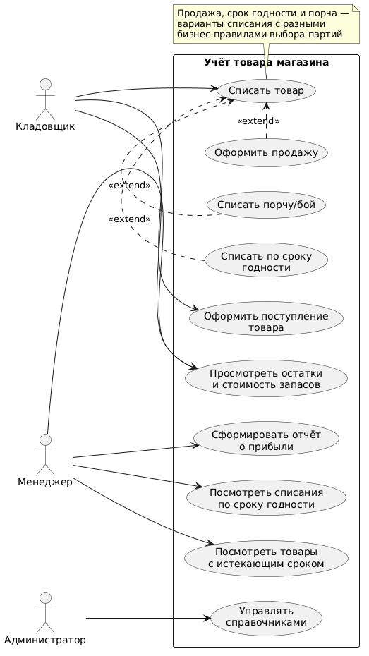
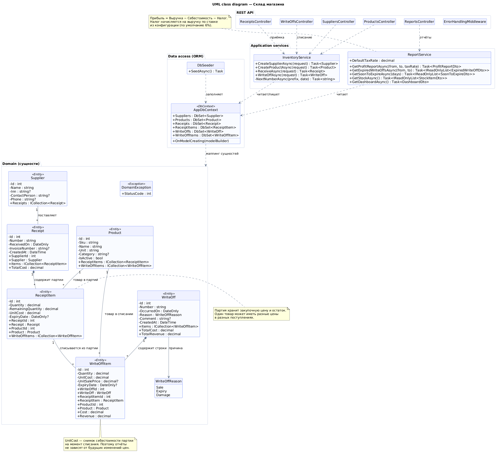
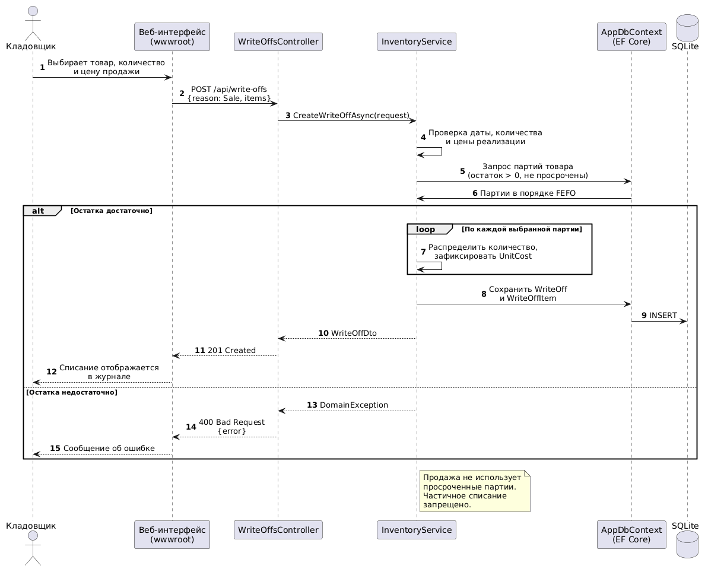
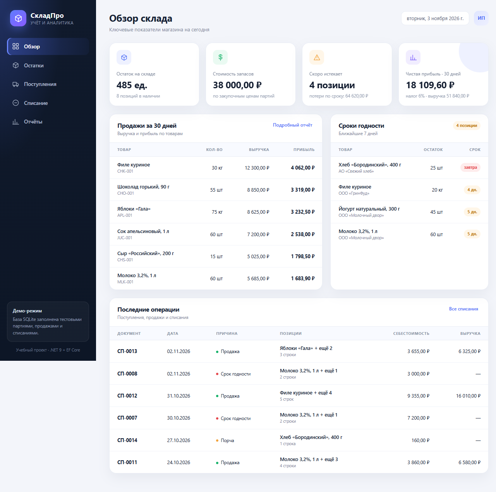
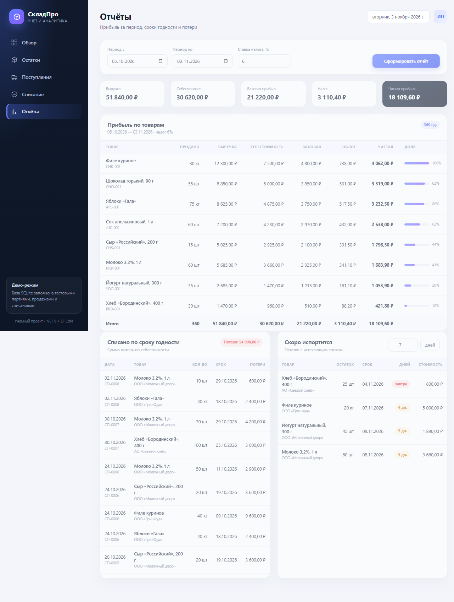
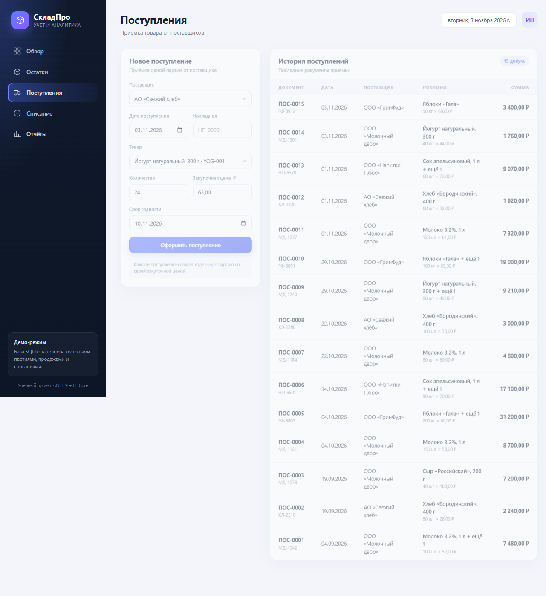
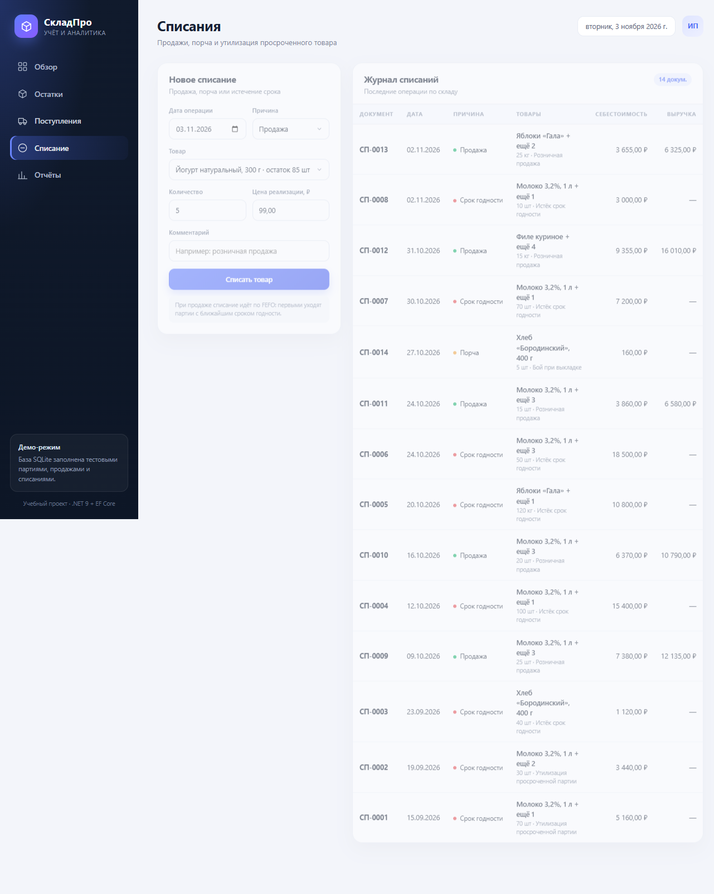
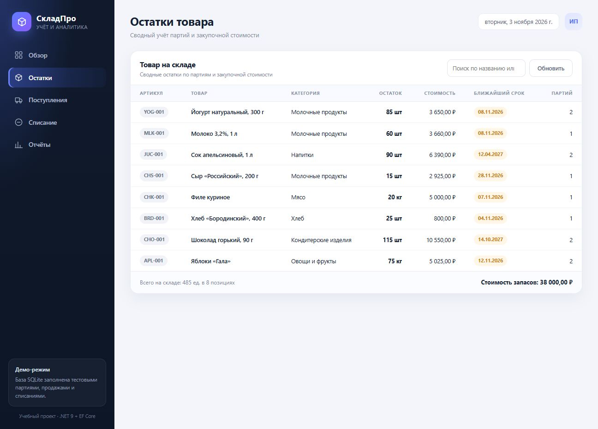

# Учёт товара магазина

Учебный проект: учёт поступлений и списаний товара, партионный склад, расчёт прибыли
за период с учётом себестоимости и налогов, отчёты по срокам годности.

## Бизнес-требования

Подробный документ с целями, ролями, функциональными требованиями, бизнес-правилами,
сценариями, нефункциональными требованиями и критериями приёмки:
**[docs/business-requirements.md](docs/business-requirements.md)**.

| ID | Бизнес-требование | Реализация |
|---|---|---|
| **BR-01** | Учёт поступлений товара от разных поставщиков | `Supplier`, `Receipt`, `ReceiptItem` |
| **BR-02** | Один товар может поступать по разным закупочным ценам | партии `ReceiptItem` со своей `UnitCost` |
| **BR-03** | Списание товара: продажа, истечение срока годности, порча | `WriteOff`, `WriteOffReason`: `Sale`, `Expiry`, `Damage` |
| **BR-04** | Фиксация цены реализации и фактической себестоимости партии | снимки `UnitSalePrice` и `UnitCost` в `WriteOffItem` |
| **BR-05** | Автоматическое распределение списания по партиям по FEFO | алгоритм в `InventoryService` |
| **BR-06** | Прибыль за период с учётом себестоимости и налогов | `GET /api/reports/profit` |
| **BR-07** | Товары, списанные по истечении срока годности, и сумма потерь | `GET /api/reports/expired-write-offs` |
| **BR-08** | Товары с истекающим сроком годности | `GET /api/reports/soon-to-expire?days=7` |
| **BR-09** | Актуальные остатки и стоимость запасов | `GET /api/reports/stock` |
| **BR-10** | Работа без ручного заполнения данных при проверке | автоматическое создание SQLite и демо-данные |

**Стек:** C# / .NET 9, ASP.NET Core Web API, Entity Framework Core 9 (ORM, аналог JPA/Hibernate),
SQLite, минимальный frontend на HTML/CSS/JavaScript без сборщика.

---

## Содержание

- [Бизнес-требования](#бизнес-требования)
- [Возможности](#возможности)
- [UML-диаграммы](#uml-диаграммы)
- [Архитектура](#архитектура)
- [Модель данных](#модель-данных)
- [Бизнес-правила и расчёты](#бизнес-правила-и-расчёты)
- [Скриншоты](#скриншоты)
- [Запуск](#запуск)
- [REST API](#rest-api)
- [Структура проекта](#структура-проекта)

---

## Возможности

- справочники товаров и поставщиков;
- поступление товара от поставщика с указанием количества, закупочной цены и срока годности;
- **партионный учёт**: каждый документ поступления создаёт отдельную партию, поэтому один
  и тот же товар может иметь разную закупочную цену;
- списание товара с причиной: **продажа**, **истечение срока годности**, **порча/бой**;
- автоматическое распределение списания по партиям по принципу **FEFO** (first expired — first out);
- фиксация себестоимости партии в момент списания — история отчётов не зависит от будущих изменений цен;
- отчёт о прибыли за период: по товарам и итогам, с выручкой, себестоимостью, валовой прибылью,
  налогом и чистой прибылью;
- отчёт о списанных по истечении срока годности товарах с суммой потерь;
- отчёт о товарах, которые скоро испортятся (по умолчанию — в течение 7 дней);
- сводные остатки и стоимость запасов;
- демонстрационная база автоматически заполняется при первом запуске.

---

## UML-диаграммы

Все диаграммы находятся в папке [`docs/diagrams/`](docs/diagrams/).

### 1. Диаграмма вариантов использования



Показывает акторов и цели системы: приёмка товара, списание (продажа, срок годности,
порча), просмотр остатков, отчёты о прибыли и сроках годности, управление справочниками.

### 2. Диаграмма классов



Показывает доменные сущности, enum причины списания, слой доступа к данным через
`AppDbContext`, сервисы прикладной логики и REST-контроллеры.

Ключевые связи:

| Связь | Кратность | Смысл |
|---|---|---|
| `Supplier` → `Receipt` | 1 : N | поставщик поставляет товар документами |
| `Receipt` → `ReceiptItem` | 1 : N | документ содержит партии товара |
| `Product` → `ReceiptItem` | 1 : N | товар встречается в разных партиях с разной ценой |
| `WriteOff` → `WriteOffItem` | 1 : N | документ списания содержит строки |
| `ReceiptItem` → `WriteOffItem` | 1 : N | строка списания ссылается на конкретную партию |
| `WriteOff` → `WriteOffReason` | N : 1 | причина: продажа / срок годности / порча |

### 3. Диаграмма последовательности



Описывает процесс продажи: запрос из интерфейса, проверку данных, выбор партий по FEFO,
фиксацию себестоимости, сохранение документа и обработку ситуации с недостатком остатка.

---

## Архитектура

Проект разделён на слои, зависимости направлены внутрь — от API к домену:

```
┌──────────────────────────────────────────────────────────┐
│  wwwroot (HTML + CSS + JS)  — минимальный интерфейс      │
└──────────────────────────┬───────────────────────────────┘
                           │ fetch / JSON
┌──────────────────────────▼───────────────────────────────┐
│  Controllers (ASP.NET Core Web API)                      │
│  Suppliers · Products · Receipts · WriteOffs · Reports   │
└──────────────────────────┬───────────────────────────────┘
                           │ DTO / команды
┌──────────────────────────▼───────────────────────────────┐
│  Services                                                │
│  InventoryService — приёмка, списание, FEFO              │
│  ReportService    — прибыль, просрочка, остатки          │
└──────────────────────────┬───────────────────────────────┘
                           │ LINQ
┌──────────────────────────▼───────────────────────────────┐
│  Data (EF Core)                                          │
│  AppDbContext · конфигурация связей · DbSeeder           │
└──────────────────────────┬───────────────────────────────┘
                           │
┌──────────────────────────▼───────────────────────────────┐
│  Domain                                                  │
│  Supplier · Product · Receipt · ReceiptItem              │
│  WriteOff · WriteOffItem · WriteOffReason                │
└──────────────────────────────────────────────────────────┘
```

- **Domain** — сущности и бизнес-исключение `DomainException`, не зависят от ASP.NET Core.
- **Data** — `AppDbContext` (EF Core), ограничения, индексы, каскады, демо-данные.
- **Services** — бизнес-логика: валидация, выбор партий, расчёт отчётов.
- **Controllers** — HTTP-контракт, DTO, коды ответов; контроллеры не содержат расчётов.
- **wwwroot** — SPA без фреймворка: навигация, формы, таблицы, отчёты.

---

## Модель данных

### Сущности

- **Supplier** — поставщик (название, ИНН, контактное лицо, телефон).
- **Product** — товар (артикул, название, единица измерения, категория).
- **Receipt** — документ поступления (номер, дата, поставщик, накладная).
- **ReceiptItem** — партия товара: количество, остаток, закупочная цена, срок годности.
- **WriteOff** — документ списания (номер, дата, причина, комментарий).
- **WriteOffItem** — строка списания: партия, количество, себестоимость, цена продажи, срок годности.

### Почему партии, а не одна цена у товара

Требование «товар может иметь различную цену при поступлениях» решается через `ReceiptItem`:
каждая приёмка создаёт новую партию со своей `UnitCost`. При списании в `WriteOffItem`
сохраняется снимок `UnitCost` и ссылка на партию. Поэтому:

- остаток и себестоимость считаются точно по партиям;
- продажа может брать товар из нескольких партий с разной ценой;
- отчёты остаются корректными, если закупочные цены изменятся позже.

### ORM

EF Core используется как ORM (аналог JPA/Hibernate):

- `DbSet<T>` для каждой сущности;
- `OnModelCreating` — связи, индексы, точность decimal, запрет каскадного удаления партий;
- LINQ-запросы вместо ручного SQL;
- `EnsureCreated()` создаёт схему SQLite при старте;
- `DbSeeder` заполняет базу, если товаров ещё нет.

Файл базы: `src/Warehouse.Api/App_Data/warehouse.db`.

---

## Бизнес-правила и расчёты

### Приёмка

- дата поступления не может быть в будущем;
- количество > 0, закупочная цена ≥ 0;
- срок годности не может быть раньше даты поступления;
- каждый документ создаёт партии с уникальными остатками.

### Списание

- дата списания не может быть в будущем;
- количество > 0; для продажи обязательно указывается цена реализации > 0;
- товар в одном документе не должен дублироваться;
- **Sale** — выбираются только непросроченные партии, порядок FEFO;
- **Expiry** — выбираются только партии с `ExpiryDate <= дата списания`;
- **Damage** — выбираются любые партии в порядке FEFO;
- если остатка не хватает, операция полностью отменяется и возвращается `400` с понятным сообщением.

### Отчёт о прибыли

Для каждой проданной строки за период:

```
Выручка        = Σ (Количество × Цена реализации)
Себестоимость  = Σ (Количество × Закупочная цена партии)
Валовая прибыль = Выручка − Себестоимость
Налог          = Выручка × Ставка налога
Чистая прибыль = Валовая прибыль − Налог
```

Ставка налога по умолчанию — **6%** (`Tax:Rate` в `appsettings.json`). Её можно передать
в запросе отчёта (`taxRate=0.06`) или изменить в интерфейсе.

Отчёт строится по снимкам себестоимости в `WriteOffItem`, а не по текущим ценам товара.

### Демонстрационные показатели

Демо-данные рассчитаны относительно текущей даты. При периоде «последние 30 дней»:

| Показатель | Значение |
|---|---:|
| Продано | 360 ед. |
| Выручка | 51 840,00 ₽ |
| Себестоимость | 30 620,00 ₽ |
| Валовая прибыль | 21 220,00 ₽ |
| Налог 6% | 3 110,40 ₽ |
| Чистая прибыль | 18 109,60 ₽ |
| Остаток на складе | 485 ед. / 38 000,00 ₽ |
| Скоро истекает (7 дней) | 4 позиции |
| Потери по сроку годности (всего) | 64 620,00 ₽ |

---

## Скриншоты

### Обзор склада



### Отчёты: прибыль, просрочка и сроки годности



### Поступления



### Списания



### Остатки



---

## Запуск

Требуется **.NET SDK 9.0** или новее.

```bash
dotnet restore src/Warehouse.Api/Warehouse.Api.csproj
dotnet run --project src/Warehouse.Api
```

`dotnet run` сам восстановит зависимости, поэтому `dotnet restore` можно пропустить.

Приложение откроется по адресу: **http://localhost:5099**

База создаётся автоматически в `src/Warehouse.Api/App_Data/warehouse.db`
и заполняется демо-данными при первом запуске.

Сброс демо-данных:

```bash
# остановить приложение, затем удалить файл базы
rm src/Warehouse.Api/App_Data/warehouse.db
dotnet run --project src/Warehouse.Api
```

Порт можно изменить через `--urls`, например:

```bash
dotnet run --project src/Warehouse.Api --urls http://localhost:8080
```

---

## REST API

Базовый URL: `http://localhost:5099`

| Метод | Путь | Назначение |
|---|---|---|
| GET | `/api/suppliers` | список поставщиков |
| POST | `/api/suppliers` | создать поставщика |
| GET | `/api/products` | товары с остатками |
| POST | `/api/products` | создать товар |
| GET | `/api/receipts?limit=50&from=&to=` | поступления с партиями |
| POST | `/api/receipts` | оформить поступление |
| GET | `/api/write-offs?limit=50&reason=&from=&to=` | журнал списаний |
| POST | `/api/write-offs` | списать товар |
| GET | `/api/reports/profit?from=&to=&taxRate=` | отчёт о прибыли |
| GET | `/api/reports/expired-write-offs?from=&to=` | списания по сроку годности |
| GET | `/api/reports/soon-to-expire?days=7` | товары с истекающим сроком |
| GET | `/api/reports/stock` | сводные остатки |
| GET | `/api/reports/dashboard` | показатели для главного экрана |

### Пример поступления

```http
POST /api/receipts
Content-Type: application/json

{
  "supplierId": 1,
  "receivedOn": "2026-11-03",
  "invoiceNumber": "МД-1301",
  "items": [
    {
      "productId": 1,
      "quantity": 24,
      "unitCost": 63.00,
      "expiryDate": "2026-11-10"
    }
  ]
}
```

### Пример продажи

```http
POST /api/write-offs
Content-Type: application/json

{
  "occurredOn": "2026-11-03",
  "reason": "Sale",
  "comment": "Розничная продажа",
  "items": [
    { "productId": 1, "quantity": 5, "unitSalePrice": 99.00 }
  ]
}
```

Причины списания: `Sale`, `Expiry`, `Damage`.

### Пример ответа отчёта о прибыли

```json
{
  "from": "2026-10-05",
  "to": "2026-11-03",
  "taxRate": 0.06,
  "lines": [
    {
      "productId": 6,
      "sku": "CHK-001",
      "name": "Филе куриное",
      "unit": "кг",
      "quantitySold": 30,
      "revenue": 12300,
      "cost": 7500,
      "grossProfit": 4800,
      "tax": 738,
      "netProfit": 4062
    }
  ],
  "totals": {
    "quantitySold": 360,
    "revenue": 51840,
    "cost": 30620,
    "grossProfit": 21220,
    "tax": 3110.4,
    "netProfit": 18109.6
  }
}
```

### Ошибки

Ошибки бизнес-правил возвращаются в едином формате:

```json
{ "error": "Недостаточно товара на складе «Молоко 3,2%, 1 л»: запрошено 1000, доступно 67." }
```

- `400` — нарушено бизнес-правило;
- `404` — не найден товар/поставщик;
- `500` — непредвиденная ошибка (логируется).

---

## Структура проекта

```
проект/
├─ docs/
│  ├─ business-requirements.md      # бизнес-требования
│  ├─ diagrams/                     # UML-диаграммы (3 шт.)
│  │  ├─ use-case.png               # варианты использования
│  │  ├─ class-diagram.png          # классы
│  │  └─ sequence-sale.png          # последовательность: продажа
│  └─ screenshots/                  # скриншоты интерфейса
├─ src/Warehouse.Api/
│  ├─ Controllers/                  # REST-контроллеры
│  ├─ Contracts/                    # DTO запросов и ответов
│  ├─ Data/                         # AppDbContext, DbSeeder
│  ├─ Domain/                       # сущности и enum
│  ├─ Infrastructure/               # middleware обработки ошибок
│  ├─ Services/                     # InventoryService, ReportService
│  ├─ wwwroot/                      # index.html, styles.css, app.js
│  ├─ App_Data/                     # SQLite (создаётся автоматически)
│  ├─ Program.cs                    # DI, EF Core, статика, запуск
│  └─ appsettings.json              # ставка налога, логирование
├─ .gitignore                       # bin/obj, локальная база SQLite
└─ README.md
```


